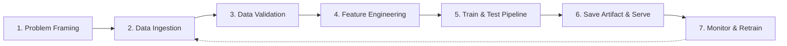

# Day 6 Complete Slide Deck & Fresher Speaker Notes

**Topic:** End-to-End ML Engineering — Lifecycle, Project Structure, Ingestion, Validation, Feature Engineering, Training/Testing Pipelines, and Introduction to Experiment Tracking, Reproducibility & Configuration Management
**Total Slides:** 39 (aligned 1-to-1 with the 8-hour schedule in `README.md`)

---

## Section 0: Welcome & Orientation (09:00 – 09:15)

### Slide 1 — Welcome to Day 6: From Notebooks to Real ML Systems
**On-Slide Bullets:**
- Week 1 (Days 1–5): Python, Pandas, Visualization, Core ML Algorithms
- Week 2 Kickoff (Day 6): Engineering Repeatable, Production-Grade ML Pipelines
- Today's Mission: Build **StreamPulse's** end-to-end Customer Churn Prediction pipeline
- Zero cloud accounts or paid keys needed — 100% reproducible in Docker + JupyterLab

**Visual / Diagram Suggestion:**
```text
Week 1 (Days 1-5)                 Day 6 (Today!)                      Days 7-8 (Next)
┌──────────────────────┐         ┌───────────────────────────┐       ┌──────────────────────────┐
│ Exploratory Notebook │   ==>   │ Modular, Validated,       │  ==>  │ Drift Monitoring, SHAP,  │
│ model.fit(X, y)      │         │ Config-Driven ML Pipeline │       │ Deployment & Governance  │
└──────────────────────┘         └───────────────────────────┘       └──────────────────────────┘
```

**Trainer Speaker Explanation (For Freshers):**
Welcome to Week 2! In Week 1, you learned how to load a CSV into Pandas and call `model.fit()`. That's like learning to cook a great omelette at home for yourself. Today is about running a **restaurant kitchen**: how do you make sure the dish tastes identical every single day, that spoiled ingredients never reach the pan, and that any chef on your team can step in and follow the recipe? That is ML Engineering!

**Common Pitfall:** Thinking ML engineering is only for senior engineers — freshers get asked about pipelines, data leakage, and project structure in almost every entry-level ML interview and first project!

---

### Slide 2 — Today's Roadmap & Syllabus
**On-Slide Bullets:**
- **In-Depth (Mandatory):**
  1. ML Lifecycle & Project Structure
  2. Data Ingestion & Data Validation
  3. Feature Engineering & Leakage Prevention
  4. End-to-End Training & Testing Pipeline
- **High-Level Overview (Introduction):**
  5. Configuration Management, Reproducibility & Experiment Tracking
- **Capstone Mini-Challenge:** Wire every stage together end-to-end!

**Trainer Speaker Explanation:**
Point out the distinction between the **6 Mandatory deep-dive topics** (where we will build, break, and test code together) and the **3 High-level Introduction topics** (where we build strong mental models and lightweight working demos so you recognize tools like YAML configs, data hashes, and MLflow immediately on the job).

---

### Slide 3 — Meet StreamPulse (Our Day 6 Case Study)
**On-Slide Bullets:**
- **Company:** StreamPulse (digital video streaming subscription platform)
- **Business Goal:** Predict which subscribers will cancel (`churned = 1`) next month
- **Why It Matters:** Retaining an existing subscriber costs 5x less than acquiring a new one
- **Data Sources:**
  - `customers_raw.csv` (CRM billing profiles — with realistic real-world messiness!)
  - `usage_events.json` (30-day logins, watch hours, support tickets)

**Check-for-Understanding:**
*Q:* Is predicting `churned` (0 or 1) a regression or classification problem, and why might accuracy alone be misleading if only 30% of customers churn?
*Expected Answer:* Binary classification. A dumb model predicting "nobody churns" gets 70% accuracy while catching 0% of churners! That's why we'll track Precision, Recall, F1, and ROC-AUC.

---

## Section 1: Module 1 — ML Lifecycle & Project Structure (09:15 – 10:15)

### Slide 4 — Why "Spaghetti Notebooks" Break in Real Teams
**On-Slide Bullets:**
- `churn_model_final_v3_ACTUALLY_FINAL.ipynb`
- Hardcoded laptop paths (`C:\Users\rahul\Downloads\data.csv`)
- Cells executed out of order (`[42]`, `[17]`, `[89]`) — fails on restart
- Data cleaning, plotting, and training tangled together
- No saved model artifact, no tests, no way to reproduce last week's score

**Visual / Diagram Suggestion:**
```text
Spaghetti Notebook Anti-Pattern:
[Load local CSV] -> [Plot] -> [Scale ALL data (!)] -> [Train] -> [Edit cell 3] -> [Re-run cell 9] -> ???
```

**Trainer Speaker Explanation:**
Ask the room: *"Has anyone ever restarted a Jupyter notebook and had it crash even though it worked 5 minutes ago?"* Almost every hand goes up! Notebooks are fantastic for **exploration and storytelling**, but terrible as your **production codebase**. On a real team, Git diffs on `.ipynb` JSON are hard to review, and you cannot schedule a messy notebook to run reliably every Monday at 2 AM.

**Common Pitfall:** Believing "never use Jupyter notebooks!" — No! Use notebooks for EDA, visualization, and prototyping; move stable, reusable steps into clean `.py` modules under `src/`.

---

### Slide 5 — The 7-Stage End-to-End ML Lifecycle
**On-Slide Bullets:**
1. **Problem Framing** — Business objective, target variable, success metric
2. **Data Ingestion** — Pull raw sources into immutable snapshots
3. **Data Validation** — Enforce schema & quality contracts before training
4. **Feature Engineering** — Convert raw fields into leak-free ML signals
5. **Model Training & Testing** — Split, cross-validate, evaluate on untouched test data
6. **Packaging & Deployment** — Save full pipeline artifact + metadata + inference test (Day 8)
7. **Monitoring & Retraining** — Track drift, accuracy decay, and refresh models (Day 7)

**Visual / Diagram Suggestion:**


**Trainer Speaker Explanation:**
Notice the dashed arrow going back from Stage 7 to Stage 2! Unlike a traditional calculator app where `2 + 2` is always `4`, an ML system lives in a changing world. Notice also how **Model Training (Stage 5) is only ONE of seven boxes** — in real jobs, Stages 2, 3, and 4 take 70–80% of an ML engineer's time!

---

### Slide 6 — Rule #1 of ML Engineering: Separate Exploration from Production Code
**On-Slide Bullets:**
- **Notebooks (`notebooks/`)**: Exploration, charts, quick hypotheses, demos
- **Source Modules (`src/`)**: Clean, testable, importable Python functions & classes
- **Configs (`configs/`)**: Tunable YAML settings (paths, hyperparameters, thresholds)
- **Data (`data/`)**: Immutable `raw/` vs. regenerated `processed/`
- **Artifacts (`artifacts/`)**: Output models (`.joblib`), reports (`.json`), logs

**Trainer Speaker Explanation:**
Use the **Restaurant Kitchen Analogy**:
- `data/raw/` = Cold storage pantry (never edit the raw delivery boxes!).
- `configs/` = Recipe card on the wall.
- `src/` = Specialized cooking stations (prep station, grill station, plating station).
- `artifacts/` = Finished dish ready for the customer.
- `tests/` = Head chef tasting before the dish leaves the kitchen.

---

### Slide 7 — Anatomy of a Clean Production ML Repository
**On-Slide Bullets:**
- Every file has **one clear home** and **one clear responsibility**
- Anyone new to the team can find data validation in 5 seconds
- Relative paths + configs ensure code runs identically on Windows, Mac, Linux, and CI servers

**Visual / Diagram Suggestion:**
```text
streampulse-churn/
├── configs/
│   └── train_config.yaml       # All tunable settings
├── data/
│   ├── raw/                    # Read-only raw snapshots
│   └── processed/              # Cleaned outputs (gitignored)
├── notebooks/                  # EDA & demos only
├── src/
│   ├── ingestion/              # Load & join sources
│   ├── validation/             # Schema & quality contracts
│   ├── features/               # Feature transforms
│   ├── training/               # Pipeline fit & evaluation
│   └── inference/              # Load .joblib & predict
├── artifacts/                  # Saved models & metrics (gitignored)
├── tests/                      # Automated pytest checks
├── Dockerfile & requirements.txt
└── README.md
```

**Common Pitfall:** Committing huge `.csv` datasets or `.joblib` models directly into Git! Explain that `.gitignore` keeps large data/artifacts out of Git (teams use S3/GCS/DVC/model registries instead).

---

### Slide 8 — Writing Modular Python Functions (Not Copy-Paste Cells)
**On-Slide Bullets:**
- Give each stage a **pure function** with explicit inputs and outputs
- Add type hints (`df: pd.DataFrame -> dict`) and short docstrings
- Never rely on hidden global variables mutated 10 cells above
- Modular functions can be called from notebooks, CLI scripts, APIs, AND `pytest`!

**Check-for-Understanding:**
*Q:* If a teammate asks you to change the missing-value check on `customers_raw.csv`, which folder should you open first in our clean project layout?
*Expected Answer:* `src/validation/` (and possibly `configs/train_config.yaml` if the threshold is configurable!).

---

### Slide 9 — Live Demo Transition: Module 1
**On-Slide Bullets:**
- Open **`01_demo_ml_lifecycle_and_project_structure.ipynb`**
- Inspect StreamPulse's raw table & class distribution
- Programmatically scaffold the folder tree under `artifacts/streampulse_project_demo/`
- Write and import our first modular helper `src/ingestion/inspector.py`

---

## Section 2: Module 2 — Data Ingestion & Data Validation (10:30 – 11:45)

### Slide 10 — What Is Data Ingestion?
**On-Slide Bullets:**
- Gathering raw data from one or more upstream sources into your ML pipeline
- Common real-world sources:
  - Batch files: CSV, Parquet, JSON
  - Databases & Warehouses: PostgreSQL, BigQuery, Snowflake
  - APIs & Event Streams: REST endpoints, Kafka
- Core ingestion duties: **extract → standardize schema/text → deduplicate → merge → record lineage**

**Visual / Diagram Suggestion:**
```text
CRM Export (customers_raw.csv) ──┐
                                 ├──► Standardize & Deduplicate ──► Left Join on customer_id ──► Ingested Dataset + Metadata (SHA-256)
App Events (usage_events.json) ──┘
```

**Trainer Speaker Explanation:**
In Kaggle competitions, someone hands you one spotless `train.csv`. In real companies, customer billing lives in a Postgres CRM export (`CSV`) while app clicks live in an analytics event log (`JSON`). Ingestion brings them together safely and logs *exactly* which files were read!

---

### Slide 11 — Four Golden Rules of Reliable Data Ingestion
**On-Slide Bullets:**
1. **Never overwrite raw files** — treat `data/raw/` as read-only evidence.
2. **Standardize early** — trim whitespace (`" Basic "` → `"basic"`), unify casing (`"us"` → `"US"`), normalize column names.
3. **Verify join keys explicitly** — deduplicate primary keys and use `pd.merge(..., validate="one_to_one")` so surprise duplicates never silently multiply rows!
4. **Record lineage metadata** — timestamp, file paths, row counts before/after, and **SHA-256 file hash**.

**Common Pitfall:** Doing `df.merge(other, on="customer_id")` without checking duplicates first! If 3 customers appear twice in both tables, a careless merge silently creates 12 rows (Cartesian blow-up) and leaks duplicates across train and test!

---

### Slide 12 — Why Data Validation? ("Garbage In, Garbage Out — Silently!")
**On-Slide Bullets:**
- Traditional software crashes with a `TypeError` when data is wrong.
- **ML models do NOT crash** when `age = -12`, `tenure_months = -5`, or `monthly_charges = 999.99`!
- Silent data bugs cause mysterious accuracy drops weeks later in production.
- **Analogy:** Data Validation is **Airport Security** — bad bags are stopped at the gate before boarding the plane!

**Trainer Speaker Explanation:**
Tell a quick story: Imagine an upstream backend engineer accidentally deploys a bug that records `monthly_charges` in cents (`1599` instead of `15.99`) or adds a new tier `"ultra_vip"`. Without Data Validation, your nightly retraining job happily trains on broken numbers and silently ships a broken churn model at 3 AM.

---

### Slide 13 — The 6 Essential Data Validation Checks (Your Data Contract)
**On-Slide Bullets:**
1. **Schema Check:** Are all required columns present with expected types?
2. **Primary Key Integrity:** Are IDs non-null and unique?
3. **Missingness Budget:** Is null percentage per column below limit (e.g., `< 15%`)?
4. **Numeric Bounds / Ranges:** `18 <= age <= 100`, `tenure_months >= 0`, `0 <= monthly_charges <= 100`
5. **Allowed Categories (Enums):** `plan_tier ∈ {basic, standard, premium}`
6. **Target Integrity:** Label column contains only valid classes (`{0, 1}`) with no nulls.

**Visual / Diagram Suggestion:**
```text
Incoming Batch ──► [ Schema & Quality Gate ]
                        ├── PASS ──► Feature Engineering & Training
                        └── FAIL ──► Fail-Fast (Stop Pipeline) OR Quarantine Bad Rows + JSON Audit Report
```

---

### Slide 14 — Fail-Fast vs. Row Quarantine: When to Use Which?
**On-Slide Bullets:**
- **Fail-Fast (Halt Entire Pipeline):**
  - Missing required column (schema broke!)
  - >15% missing values across a critical feature
  - Invalid target labels or empty dataset
- **Row Quarantine (Filter & Log Bad Rows):**
  - 4 corrupted customer records out of 10,000 (e.g., `age = 10` or negative charge)
  - Route clean rows forward; save bad rows + `failure_reason` to `quarantine.csv` for upstream engineers to fix!

**Check-for-Understanding:**
*Q:* Suppose today's batch is missing the `monthly_charges` column completely, while yesterday's batch had 2 rows with `age = -1`. Which one should Fail-Fast and which one can Quarantine?
*Expected Answer:* Missing column = Fail-Fast (every row is broken; upstream schema changed). 2 rows with `age = -1` = Quarantine (keep 99.8% of healthy data moving while alerting data owners about the 2 bad rows).

---

### Slide 15 — Batch Validation vs. Row-Level Validation (Pydantic Preview)
**On-Slide Bullets:**
- **Batch Training Data:** Pandas rule checks, Pandera, or Great Expectations → produce a JSON Validation Report.
- **Single API Request (Inference):** **Pydantic** validates one JSON customer payload in microseconds with clear field-level error messages!
- Bonus: You'll see Pydantic again on **Day 14** for LLM Structured Outputs!

---

### Slide 16 — Live Demo & Exercise 1 Transition
**On-Slide Bullets:**
- Live Demo: **`02_demo_data_ingestion_and_validation.ipynb`**
  - Ingest `customers_raw.csv` + `usage_events.json`
  - Validate clean data vs. `customers_corrupted_batch.csv`
  - Inspect Pydantic single-record rejection
- Real-Time Exercise 1 (25 min): **`03_exercise_data_ingestion_and_validation_starter.ipynb`**

---

## Section 3: Module 3 — Feature Engineering & Leakage Prevention (11:45 – 13:00)

### Slide 17 — What Is Feature Engineering?
**On-Slide Bullets:**
- Raw columns describe *what happened*; engineered features capture **why it matters**.
- Often delivers bigger accuracy jumps than switching from Logistic Regression to complex ensembles.
- Four common feature engineering families:
  1. **Domain Ratios & Rates** (`monthly_charges / (login_days_30d + 1)`)
  2. **Binary Flags / Thresholds** (`is_new_customer = tenure <= 3`, `high_ticket_flag`)
  3. **Missing Value Imputation** (median for numeric, mode for categorical)
  4. **Encoding & Scaling** (`OneHotEncoder`, `StandardScaler`)

**Trainer Speaker Explanation:**
Think about a customer paying `$25/month`. Is `$25` expensive? It depends! If they log in 28 days a month, `$25 / 29 = $0.86/login` — amazing value! If they logged in once, `$25 / 2 = $12.50/login` — they're about to cancel! A simple ratio gives a linear model instant access to that business insight.

---

### Slide 18 — Watch Out for Division-by-Zero & Edge Cases!
**On-Slide Bullets:**
- What if a customer had `login_days_30d == 0`?
- `monthly_charges / login_days_30d` produces `inf` (infinity) → crashes scikit-learn!
- **Safe engineering pattern:** Add `+ 1.0` smoothing in denominators:
  - `charges_per_login = monthly_charges / (login_days_30d + 1.0)`
  - `tickets_per_tenure_month = support_tickets_30d / (tenure_months + 1.0)`
- Keep domain transforms **stateless (row-by-row)** so training and live inference match 100%!

---

### Slide 19 — The #1 Beginner Trap: Data Leakage
**On-Slide Bullets:**
- **Definition:** Information from the test set (or the future) accidentally sneaks into model training.
- **Result:** Glowing offline test accuracy (95%!) followed by humiliating production failure (62%!).
- **Analogy:** Peeking at the final exam answer key while studying — your practice grade is fake!

**Visual / Diagram Suggestion:**
```text
WRONG (Data Leakage!):
Full Dataset ──► StandardScaler.fit_transform(ALL) ──► train_test_split() ──► Fake High Score!
                      ▲
                      └── Test set mean & std leaked into training!

RIGHT (Leak-Free!):
Full Dataset ──► train_test_split()
                      ├── X_train ──► scaler.fit_transform(X_train) ──► model.fit()
                      └── X_test  ──► scaler.transform(X_test)      ──► Honest Score!
```

**Trainer Speaker Explanation:**
Repeat this mantra three times with the class: **"Split first! Fit ONLY on train! Transform on test!"** This applies to *every* stateful step: `SimpleImputer`, `StandardScaler`, `OneHotEncoder`, PCA, and target encoders.

---

### Slide 20 — Two Other Sneaky Forms of Leakage to Watch For
**On-Slide Bullets:**
1. **Target Leakage (Future Columns):** Including a column like `cancellation_email_sent_date` or `refund_issued` that only exists *after* a customer already churned!
2. **Duplicate Leakage:** Same customer appears twice — one copy lands in `train`, the other in `test`! (Why our Module 2 deduplication matters!)

**Check-for-Understanding:**
*Q:* Does creating `charges_per_login = monthly_charges / (login_days_30d + 1)` before `train_test_split` cause data leakage? What about filling missing `age` with `df["age"].median()` before `train_test_split`?
*Expected Answer:* `charges_per_login` uses only that single row → NO leakage. `df["age"].median()` uses all rows including the test set → YES, leakage! Imputation must be fitted inside the training split.

---

### Slide 21 — Handling Mixed Data Types with `ColumnTransformer`
**On-Slide Bullets:**
- Real tables mix numbers (`age`, `charges`) and strings (`plan_tier`, `country`).
- You cannot scale strings, and you shouldn't one-hot encode continuous prices!
- **`ColumnTransformer`** routes each column group through its own mini-pipeline in parallel and concatenates the clean numeric matrix automatically.

**Visual / Diagram Suggestion:**
```text
                     ┌── Numeric Cols ──► SimpleImputer(median) ────────► StandardScaler ──┐
Raw Feature Table ───┤                                                                     ├──► Clean Matrix
                     └── Categoric Cols ► SimpleImputer(most_frequent) ─► OneHotEncoder ───┘
```

---

### Slide 22 — Surviving Production Surprises: `handle_unknown="ignore"`
**On-Slide Bullets:**
- Training data has countries `["US", "IN", "UK", "CA", "DE"]`.
- Six months later, StreamPulse launches in Japan (`country = "JP"`).
- Default `OneHotEncoder()` **crashes with `ValueError: Found unknown categories ['JP']`**!
- Fix: Always set `OneHotEncoder(handle_unknown="ignore", sparse_output=False)` — unknown categories encode cleanly to all zeros without crashing production!

---

### Slide 23 — Live Demo & Exercise 2 Transition
**On-Slide Bullets:**
- Live Demo: **`04_demo_feature_engineering_and_leakage.ipynb`**
  - Prove scaler leakage numerically
  - Create 4 StreamPulse domain features & verify signal by churn group
  - Build `ColumnTransformer` and survive an unseen `"JP"` customer with missing `age`
- Real-Time Exercise 2 (25 min): **`05_exercise_feature_engineering_starter.ipynb`**

---

## Section 4: Module 4 — Training & Testing Pipeline (13:45 – 15:00)

### Slide 24 — Why Wrap Everything Inside `sklearn.pipeline.Pipeline`?
**On-Slide Bullets:**
- Chains `Feature Engineering → ColumnTransformer → Classifier` into **one single Python object**!
- **Benefit 1 (Zero Leakage in CV):** `cross_val_score(pipeline, X_train, y_train)` automatically refits imputers, scalers, and encoders *inside every fold*!
- **Benefit 2 (Zero Training-Serving Skew):** Save ONE `.joblib` file instead of juggling separate `imputer.pkl`, `scaler.pkl`, `encoder.pkl`, and `model.pkl`!
- **Benefit 3 (Clean API):** Pass raw customer rows to `pipeline.predict_proba(new_df)` directly!

**Visual / Diagram Suggestion:**
```text
Raw DataFrame ──► [ FunctionTransformer ] ──► [ ColumnTransformer ] ──► [ Classifier ] ──► Churn Probability
                  \____________________________ ONE sklearn.pipeline.Pipeline ____________________________/
```

---

### Slide 25 — Stratified Splitting: Keeping Class Balance Honest
**On-Slide Bullets:**
- StreamPulse churn rate is ~30% (`churned = 1`) vs. 70% retained (`churned = 0`).
- Plain `train_test_split(X, y)` can accidentally put 36% churners in train and 21% in test!
- Always pass **`stratify=y`** for classification so train and test share the exact same class ratio!
- Never touch `X_test` until your final model selection is complete ("Lock `X_test` in a vault!").

---

### Slide 26 — Model Selection with Stratified K-Fold Cross-Validation
**On-Slide Bullets:**
- A single validation split can be lucky or unlucky.
- **5-Fold Stratified Cross-Validation** splits `X_train` into 5 balanced folds, trains 5 times (holding out 1 fold each time), and reports **mean ± std**.
- Compare diverse baselines fairly on the exact same folds:
  - Simple linear baseline: **Logistic Regression**
  - Non-linear tree ensemble: **Random Forest**
  - Boosted trees: **Gradient Boosting**

**Trainer Speaker Explanation:**
Highlight a huge real-world lesson freshers love: **always start with a simple baseline like Logistic Regression!** On our StreamPulse dataset, well-engineered features let Logistic Regression achieve ~0.82 CV ROC-AUC — right alongside or slightly beating heavier tree ensembles while being faster and easier to explain (foreshadowing Day 8 Explainability!).

---

### Slide 27 — Picking the Right Evaluation Metrics for Churn
**On-Slide Bullets:**
- **Confusion Matrix:** True Positives (caught churners), False Positives (unnecessary discount emails), False Negatives (missed churners!).
- **Precision:** Of customers we flagged as churners, how many actually churned?
- **Recall:** Of all real churners, what % did we successfully catch?
- **F1-Score:** Harmonic mean balancing Precision & Recall.
- **ROC-AUC:** Threshold-independent ranking quality (`0.5` = random coin flip, `1.0` = perfect).

**Check-for-Understanding:**
*Q:* StreamPulse wants to send a low-cost `$2` retention email to predicted churners, while losing a customer costs `$180/year`. Should we care more about **Recall** or **Precision**, and should we raise or lower the probability threshold from `0.50`?
*Expected Answer:* Care more about **Recall** (missing a `$180` customer is far costlier than sending an extra `$2` email!). Lowering the threshold (e.g., from `0.50` to `0.35`) catches more churners (higher Recall) at the cost of a few more False Positives.

---

### Slide 28 — Artifact Serialization & Model Metadata
**On-Slide Bullets:**
- A model sitting in notebook RAM vanishes when the container restarts.
- **Serialization (`joblib.dump`)** writes the entire fitted `Pipeline` to `artifacts/churn_pipeline.joblib`.
- Always save a sibling **Model Metadata JSON** recording:
  - Model type & version
  - Exact expected raw input columns
  - Held-out test metrics (`roc_auc`, `f1`, `precision`, `recall`)

---

### Slide 29 — The Mandatory Inference Smoke Test
**On-Slide Bullets:**
- Never declare a model "done" until you:
  1. Reload the `.joblib` file from disk (`loaded = joblib.load(path)`)
  2. Assert `np.allclose(orig_probs, loaded_probs)` on `X_test`
  3. Score realistic synthetic customer profiles (1 obvious high-risk customer, 1 obvious loyal customer) and verify common-sense probabilities!
- Catches broken custom functions, missing columns, and serialization bugs immediately.

---

### Slide 30 — Live Demo & Exercise 3 Transition
**On-Slide Bullets:**
- Live Demo: **`06_demo_training_and_testing_pipeline.ipynb`**
  - 5-fold CV comparison of 3 classifiers
  - Confusion Matrix + ROC Curve on held-out test set
  - Save `.joblib` + metadata JSON & run live 2-customer smoke test
- Real-Time Exercise 3 (25 min): **`07_exercise_training_pipeline_starter.ipynb`**

---

## Section 5: Module 5 — Introduction to Config Management, Reproducibility & Experiment Tracking (15:15 – 16:15)

### Slide 31 — The Friday Afternoon Nightmare
**On-Slide Bullets:**
- Your manager asks: *"Tuesday's model got 0.85 ROC-AUC. Let's ship that exact one!"*
- You check your notebook: you already overwrote `max_depth`, changed features, and re-ran cells 12 times.
- You cannot recreate Tuesday's model!
- **The Cure (3 High-Level Pillars):**
  1. **Configuration Management**
  2. **Reproducibility**
  3. **Experiment Tracking**

---

### Slide 32 — Pillar 1: Configuration Management (YAML over Magic Numbers)
**On-Slide Bullets:**
- **Magic Numbers Anti-Pattern:** `test_size=0.2`, `max_depth=6`, `"data/customers.csv"` scattered across 9 files.
- **YAML Config (`configs/train_config.yaml`):** One human-readable recipe card controlling paths, validation thresholds, feature lists, seeds, and model hyperparameters.
- Change an experiment by editing **config, not code** — zero risky code edits!

**Visual / Diagram Suggestion:**
```yaml
reproducibility:
  random_seed: 42
  test_size: 0.20
model:
  type: "random_forest"
  params:
    n_estimators: 120
    max_depth: 6
```

**Trainer Speaker Explanation:**
Use the **Recipe Card Analogy**: If you want a spicier curry, you don't rebuild the stove — you adjust `"chili_spoons: 2"` on the recipe card! In bigger projects you'll later meet tools like **Hydra** or **Pydantic Settings**, all built on this exact same idea.

---

### Slide 33 — Pillar 2: Reproducibility — The 4 Ingredients
**On-Slide Bullets:**
1. **Deterministic Seeds:** Lock `random.seed(42)`, `np.random.seed(42)`, and `random_state=42` everywhere.
2. **Data Fingerprinting:** Record a **SHA-256 hash** of raw input files (if 1 byte changes in `customers_raw.csv`, the hash changes!).
3. **Config Snapshot:** Store the exact YAML parameters alongside the run.
4. **Pinned Environment:** Lock Python & library versions (`requirements.txt` + **Docker**, just like we used today!).

**Check-for-Understanding:**
*Q:* If I fix `random_state=42`, is my ML run guaranteed to be reproducible 6 months from now?
*Expected Answer:* Not by itself! If someone updated `customers_raw.csv` silently or upgraded `scikit-learn` from 1.4 to 1.6, results can still change. You need all 4: seed + data hash + config + pinned environment!

---

### Slide 34 — Pillar 3: Experiment Tracking (Your ML Lab Notebook)
**On-Slide Bullets:**
- Chemists never run 20 experiments without writing down ingredients and results in a **lab notebook**.
- Every ML training run should automatically log:
  - **Metadata:** `run_id`, `timestamp`, `data_hash`, `git_commit`, `sklearn_version`
  - **Parameters:** `model_type`, hyperparameters, `random_seed`
  - **Metrics:** `cv_roc_auc`, `test_roc_auc`, `test_f1`
  - **Artifacts:** Link to saved `.joblib` model & confusion matrix plot
- **Industry Tools You'll Meet:** MLflow (open-source standard), Weights & Biases (W&B), Comet, Vertex AI / SageMaker Experiments.

---

### Slide 35 — Under the Hood: Local JSONL Tracker → MLflow
**On-Slide Bullets:**
- Today we log runs to a clean, zero-setup `artifacts/experiments.jsonl` ledger so you see *exactly* what trackers store!
- Switching to **MLflow** on the job takes ~6 lines of code:
  - `mlflow.start_run()`
  - `mlflow.log_params(...)`
  - `mlflow.log_metrics(...)`
  - `mlflow.sklearn.log_model(...)`

---

### Slide 36 — Live Demo Transition: Module 5
**On-Slide Bullets:**
- Open **`08_demo_experiments_reproducibility_and_config.ipynb`**
- Load `configs/train_config.yaml`
- Prove seed reproducibility (`seed=42` vs `seed=42` → identical; `seed=99` → different)
- Run 3 tracked experiments, inspect the JSONL ledger, and plot the leaderboard!

---

## Section 6: Capstone & Wrap-Up (16:15 – 17:00)

### Slide 37 — Day 6 Capstone Mini-Challenge (30 Minutes)
**On-Slide Bullets:**
- Open **`09_capstone_end_to_end_pipeline_starter.ipynb`**
- Wire every single Day 6 stage into one clean flow:
  `YAML Config → Ingest → Validate → Feature Engineering → Train/Test Pipeline → Save Artifact → Log Experiment`
- Run the automated grader cell until you see **`[CAPSTONE COMPLETE!]`**!

---

### Slide 38 — 5-Question Rapid-Fire Recap Quiz
**On-Slide Bullets (Read one at a time; ask class to answer aloud):**
1. Why should `data/raw/` never be overwritten?
2. Name 2 checks that belong in a Data Validation contract.
3. Why must `StandardScaler.fit()` run ONLY after `train_test_split()`?
4. What parameter prevents `OneHotEncoder` from crashing on unseen production categories?
5. Name all 4 ingredients needed for true ML reproducibility.

**Expected Quick Answers:**
1. Preserves immutable audit trail / allows regenerating processed data cleanly when rules change.
2. Required columns/schema, PK uniqueness, missingness threshold, numeric bounds, allowed categories, valid target labels.
3. Prevents test-set statistics (mean/std) from leaking into training.
4. `handle_unknown="ignore"`.
5. Fixed random seeds, data hash/version, saved config/hyperparameters, pinned software environment (requirements/Docker).

---

### Slide 39 — Preview of Day 7: What Happens After Deployment?
**On-Slide Bullets:**
- Today we built a **clean, validated, leak-free, config-driven ML pipeline**.
- Tomorrow (**Day 7**), imagine 3 months pass in production:
  - What if StreamPulse launches a new pricing tier and user behavior shifts? (**Data Drift & Concept Drift**)
  - How do we detect accuracy decay before customers notice? (**Monitoring Metrics & Retraining Strategy**)
  - How do large teams share features across 10 models without duplication? (**Feature Stores, Feature Versioning & Training-Serving Skew**)
- Great work today! Push your notes, stop Docker cleanly (`docker compose down`), and see you tomorrow!
